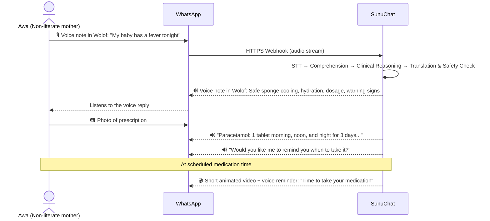
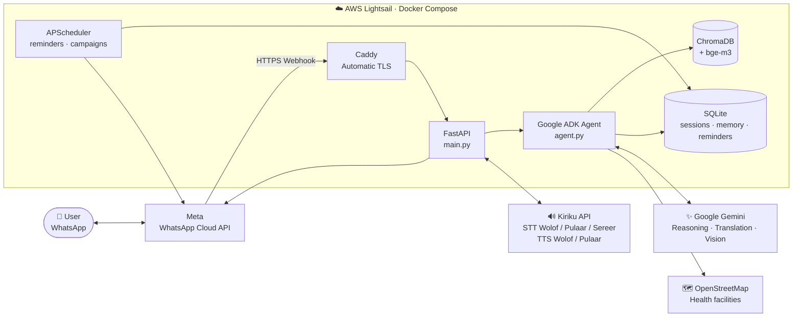
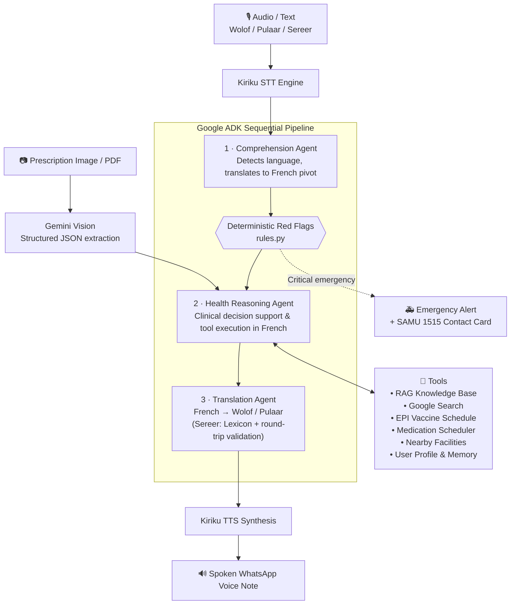
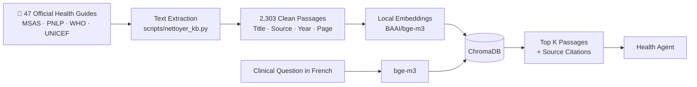
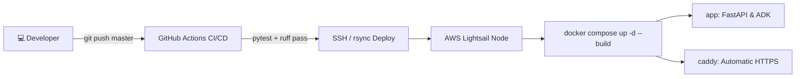

<div align="center">

# 🩺 SunuChat

**The multilingual voice-first health assistant on WhatsApp in Wolof, Pulaar, and Sereer, designed for non-literate and underserved communities.**

*Speak naturally, it listens. It responds by voice note in your native language.*


<br/>

<a href="https://wa.me/221769329923"></a>

<a href="https://wa.me/221769329923"></a>

*Scan the QR code or click the button, then send a voice note in Wolof, Pulaar, or Sereer.*

</div>

---

## Table of Contents

1. [The Problem](#-the-problem)
2. [Our Solution](#-our-solution)
3. [Key Features](#-key-features)
4. [User Experience Walkthrough](#-user-experience-walkthrough)
5. [System Architecture](#-system-architecture)
6. [Technology Stack](#-technology-stack)
7. [Clinical Safety & Reliability](#-clinical-safety--reliability)
8. [Installation & Setup](#-installation--setup)
9. [Deployment](#-deployment)
10. [Repository Structure](#-repository-structure)
11. [Impact & Roadmap](#-impact--roadmap)

---

## 🎯 The Problem

In Senegal, a significant portion of the adult population cannot read French, and many are not literate in any written language. Yet, nearly all critical healthcare information is **written and delivered exclusively in French**: prevention posters, medication leaflets, medical prescriptions, and vaccination cards.

The real-world consequences are severe:
- **Misunderstood prescriptions**: Patients miscalculate dosages or stop treatments prematurely.
- **Missed vaccination deadlines**: Children fall behind the national expanded immunization schedule (EPI / PEV).
- **Delayed emergency care**: Life-threatening red flags (severe malaria, dehydration, respiratory distress) are not identified early.
- **Geographic isolation**: Families do not know where to find the nearest functional health post (*poste de santé*).

At the same time, almost everyone uses **WhatsApp daily via voice notes**.

---

## 💡 Our Solution

**SunuChat** turns WhatsApp into a compassionate, localized community health worker available 24/7:

> 🎙️ *« Sama doom am na yaram bu tàng ci guddi gi, lan laa wara def ? »*  
> 🔊 **Voice reply in Wolof**: Immediate first-aid actions, verified safe home remedies, and clear red flags requiring an urgent visit to the health post.

- **100% Voice-First**: No reading required—no text menus, no confusing buttons.
- **Wolof & Pulaar (Fuuta)**: Spoken language is identified automatically.
- **Sereer via Lexical Anchoring**: Simply say "seereer" to switch. Since native LLMs lack deep Sereer training data, SunuChat uses an indexed medical health dictionary (Crétois) and strictly utters verified vocabulary; otherwise, it gracefully falls back to Wolof.
- **Evidence-Based & Grounded**: Grounded in official protocols from the Senegalese Ministry of Health (MSAS), National Malaria Control Program (PNLP), WHO, and UNICEF, supplemented by live Google Search for broader topics.
- **Actionable & Practical**: Delivers concrete home guidance (oral rehydration salts, safe antipyretics) and only refers to a doctor when genuinely necessary.

---

## ✨ Key Features

| | Feature | Description |
|---|---|---|
| 🎙️ | **Voice In, Voice Out** | Seamless audio-to-audio dialogue in Wolof, Pulaar, or Sereer. |
| 📖 | **Sereer Dictionary Engine** | 469 healthcare terms from Père Crétois' dictionary; word-by-word validation and round-trip back-translation before sending (see [assets/serer](assets/serer/README.md)). |
| 📚 | **Grounded RAG** | 47 official health guidelines, 2,303 indexed chunks: malaria protocols, dengue algorithms, infant immunization (EPI), and maternal nutrition. |
| 🌍 | **Broad Health Intelligence** | Live Google Search for conditions outside the local corpus (hypertension, diabetes, Pink October breast cancer screenings, active outbreaks). |
| 📄 | **Prescription OCR & Explanation** | Photo or PDF of a handwritten prescription → medications, dosages, frequency, and duration explained in spoken local language. |
| ⏰ | **Animated Medication Reminders** | Spoken reminder delivered at dosage time, rendered as an animated looping video. |
| 💉 | **Automated Vaccination Reminders** | National EPI schedule calculated from the child's birth date; reminder sent the day before each clinic appointment. |
| 🚑 | **Emergency Triage** | Deterministic rule-based detection for critical red flags → instant emergency alert + one-tap **SAMU 1515** contact card. |
| 📍 | **Nearest Health Facility** | Geolocation via WhatsApp GPS pin or neighborhood name using OpenStreetMap (Overpass & Nominatim). |
| 🌧️ | **Seasonal Prevention Campaigns** | Proactive rainy season alerts for malaria and dengue vector control sent to subscribed households. |
| 📢 | **Epidemiological Surveillance (Veille)** | Continuous monitoring of official feeds (Ministry of Health, ANACIM, WHO, APS, Le Soleil). Proactively alerts at-risk users about heatwaves, epidemics, or free vaccination drives. |
| 🧠 | **Persistent Context & Memory** | Retains language preferences, location, and children's birth dates across sessions. |

---

## 🎬 User Experience Walkthrough



---

## 🏗️ System Architecture

### High-Level Architecture



### The Three-Stage Sequential ADK Pipeline

SunuChat utilizes a **three-stage sequential agent pipeline** built on Google ADK, using **French as the clinical pivot language**:



| Pipeline Stage | Primary Function | Recommended Model |
|---|---|---|
| **Comprehension** | Language detection, intent parsing, French pivot translation | `gemini-flash-lite-latest` (ultra low-latency) |
| **Health Reasoning** | Clinical decision-making, tool execution, safety grounding | `gemini-3.8-flash` |
| **Translation** | Cultural nuance, localized audio synthesis script | `gemini-3.1-pro-preview` |
| **Prescription Vision**| Handwritten prescription OCR, dosage table extraction | `gemini-3.1-pro-preview` |

### Retrieval-Augmented Generation (RAG)



Embeddings run **locally inside the container** using `BAAI/bge-m3`—ensuring zero third-party data leakage and zero API rate-limiting for semantic search.

---

## 🧰 Technology Stack

| Layer | Component | Description |
|---|---|---|
| **Interface** | WhatsApp Cloud API | Meta Graph API: Audio voice notes, MP4 videos, vCards, GPS locations |
| **Application Server** | Python 3.12 / FastAPI | High-concurrency async webhook handling, Uvicorn, Pydantic Settings |
| **Agent Framework** | Google ADK & Gemini | Sequential pipeline, function-calling tools, conversation compaction |
| **Speech & Audio** | Kiriku Speech API | Native Senegalese STT & TTS (Wolof, Pulaar, Sereer) |
| **Semantic RAG** | ChromaDB & `bge-m3` | On-device multilingual dense retrieval over official Ministry guidelines |
| **Data Persistence** | SQLite & SQLAlchemy | Persistent memory store, user profiles, session states, scheduler jobs |
| **Task Scheduling** | APScheduler | Cron and date-based scheduling for medication and vaccine notifications |
| **Media Processing** | FFmpeg (`imageio-ffmpeg`)| Audio transcoding (Opus/OGG) and animated reminder MP4 generation |
| **Geolocation** | OpenStreetMap | Overpass API & Nominatim geocoding (no API key required) |
| **Infrastructure** | Docker Compose & Caddy | Automated Let's Encrypt TLS reverse-proxy on AWS Lightsail |
| **Test & Lint** | pytest & Ruff | 93 automated tests, zero lint warnings |

---

## 🛡️ Clinical Safety & Reliability

### Clinical Safeguards
- **Deterministic Red-Flag Interception**: Critical medical conditions (convulsions, continuous vomiting, breathing difficulties, cyanosis) are caught by deterministic regex and keyword filters (`rules.py`) before LLM generation. An emergency SAMU 1515 dispatch recommendation is immediately sent.
- **Strict Scope Boundaries**: The assistant does not invent diagnoses, never prescribes antibiotics without an official prescription, and never modifies physician-prescribed dosages.
- **Mandatory Source Attribution**: Recommendations cite official sources (MSAS, WHO, PNLP) first.

### Operational Resilience
- **Automated LLM Fallback**: If a Gemini model encounters quota exhaustion (HTTP 429) or service interruption (HTTP 503), the engine falls back down the list defined in `FALLBACK_MODELS` without user disruption.
- **Graceful Search Fallbacks**: If web search or geolocation fails, the core agent continues answering using its local RAG index.
- **Never Leave Silence**: In the event of an unrecoverable internal exception, the user always receives a polite voice note explaining the delay.

### Privacy & Data Protection
- Cryptographic Meta HMAC-SHA256 signature verification on every incoming webhook.
- No medical telemetry exported to unauthorized third parties.
- Localized RAG embeddings executed on the host.
- One-word opt-out: users can disable automated alerts anytime by messaging "stop".
- Transparent privacy policy available at `/confidentialite`.

---

## ⚙️ Installation & Setup

### Prerequisites
- Python 3.12+
- [uv](https://docs.astral.sh/uv/) package manager
- Google Gemini API key
- Meta WhatsApp Business Cloud API account
- Kiriku Speech API credentials

### Quickstart

```bash
# 1. Clone repository
git clone https://github.com/Alioukun221/Sunuchat_Voicebot.git
cd Sunuchat_Voicebot

# 2. Install dependencies with uv
uv sync

# 3. Configure environment variables
cp .env.example .env
# Edit .env with your API keys

# 4. Build local RAG vector index
uv run python -m sunuchat.knowledge build

# 5. Launch development server
uv run sunuchat
```

### Environment Configuration

Key configuration parameters from [`.env.example`](.env.example):

| Variable | Description | Default |
|---|---|---|
| `GOOGLE_API_KEY` | Google Gemini API key | *Required* |
| `AGENT_MODEL` | Clinical reasoning agent model | `gemini-3.8-flash` |
| `FAST_MODEL` | Fast comprehension / translation model | `gemini-flash-lite-latest` |
| `TRANSLATION_MODEL` | High-fidelity translation model | `gemini-3.1-pro-preview` |
| `FALLBACK_MODELS` | Comma-separated fallback models | `gemini-3.8-flash,gemini-flash-lite-latest` |
| `WHATSAPP_ACCESS_TOKEN` | Meta Graph API permanent access token | *Required* |
| `WHATSAPP_PHONE_NUMBER_ID` | WhatsApp Business sender phone number ID | *Required* |
| `WHATSAPP_VERIFY_TOKEN` | Webhook handshake verification token | *Required* |
| `WHATSAPP_APP_SECRET` | Meta app secret for HMAC validation | *Required* |
| `SPEECH_API_BASE_URL` | Kiriku Speech platform URL | *Required* |
| `SPEECH_API_KEY` | Kiriku Speech API token | *Required* |
| `EMBEDDING_MODEL` | Dense retrieval model name | `BAAI/bge-m3` |

### RAG Maintenance CLI

```bash
# List all indexed corpus documents
uv run python -m sunuchat.knowledge list

# Quick test build (first 300 passages)
uv run python -m sunuchat.knowledge build --limit 300

# Full database reindex
uv run python -m sunuchat.knowledge build --reset

# Query semantic search directly from CLI
uv run python -m sunuchat.knowledge search "how to maintain a mosquito net"
```

---

## 📢 Proactive Health Surveillance (Veille)

SunuChat does not merely wait for inquiries. Every 6 hours (`VEILLE_INTERVALLE_MIN=360`), the background surveillance worker queries verified channels:

| Source | Target Content |
|---|---|
| **Ministry of Health (MSAS)** | RSS announcements, official ministerial communiqués, situation reports |
| **ANACIM** | Meteorological & climate alerts (heatwaves, flooding, dust storms) |
| **WHO** | Disease Outbreak News (DON) specific to Senegal and West Africa |
| **APS** | Health desk of the Senegalese Press Agency |
| **Le Soleil** | Health investigative reports from the national daily |

Surveillance messages are verified, classified into alerts or educational advisories, targeted by region, and sent as voice notes to registered citizens.

---

## 🚀 Deployment

The production deployment runs on an **AWS Lightsail instance (Ubuntu 24.04, 4GB RAM, Paris eu-west-3)** managed by Docker Compose and Caddy:



Manual deployment:
```bash
rsync -avz --exclude .venv --exclude .git --exclude __pycache__ --exclude .env \
  -e "ssh -i ~/.ssh/sunuchat.pem" ./ ubuntu@<SERVER_IP>:~/sunuchat/

ssh -i ~/.ssh/sunuchat.pem ubuntu@<SERVER_IP> \
  "cd ~/sunuchat && docker compose up -d --build"
```

---

## 📁 Repository Structure

```
src/sunuchat/
├── main.py         FastAPI web application, webhook ingestion, health check
├── agent.py        Google ADK sequential pipeline (Comprehension → Health → Translation)
├── rules.py        Deterministic clinical safety rules and EPI vaccine schedule
├── knowledge.py    RAG engine: cleaning, chunking, ChromaDB dense retrieval
├── ordonnance.py   Multimodal prescription analysis (Gemini Vision JSON extraction)
├── speech.py       Kiriku voice client (STT & TTS), audio normalization, video rendering
├── whatsapp.py     WhatsApp Cloud API connector (messages, templates, locations, media)
├── reminders.py    Dosage and vaccination scheduler (APScheduler)
├── campaigns.py    Community campaigns, seasonal alerts, subscriber management
├── veille.py       Proactive epidemiological watch and alert dispatcher
├── places.py       Nearby health facility search (OpenStreetMap Overpass/Nominatim)
├── memory.py       SQLite session persistence and user profile management
├── onboarding.py   Static voice prompts, administrative commands ("stop", "alerte")
├── serer.py        Sereer lexical dictionary, phonetics, and round-trip verification
├── textes.py       Localized text templates in Wolof and Pulaar
├── images.py       Media caching and upload management for Meta Graph API
└── config.py       Application settings and environment validation
assets/animations/  Looping reminder animation templates (medication, vaccination)
assets/serer/       Sereer dictionary, Père Crétois lexicon, validated phrases
data/kb/            Cleaned corpus of official health guidelines
deploy/             Production Caddyfile, setup scripts
tests/              Pytest suite (93 unit and integration tests)
```

Run test suite and style linter:
```bash
uv run pytest -q
uv run ruff check src tests
```

---

## 🌱 Impact & Roadmap

- **Target Audience**: Mothers and caregivers in rural and peri-urban areas, elders, non-literate community members, and *Bajenu Gox* (community health godmothers).
- **Scalability**: Zero client install required, 100% voice-based, minimal server footprint.
- **Future Milestones**:
  - Direct field validation of dialectical variations with native speakers and community healthcare workers.
  - Interactive voice reminders outside the 24-hour window using Meta approved video-header templates.
  - Anonymized epidemiological dashboard for district health authorities.
  - Direct integrations with local health posts and the National Malaria Control Program (PNLP).

---

<div align="center">

**SunuChat** · *Sunu* = "Our" in Wolof: *Our health assistant, in our own language.*

⚠️ *SunuChat provides general health guidance and does not replace professional medical evaluation. In case of an emergency, call **SAMU Senegal at 1515**.*

</div>
